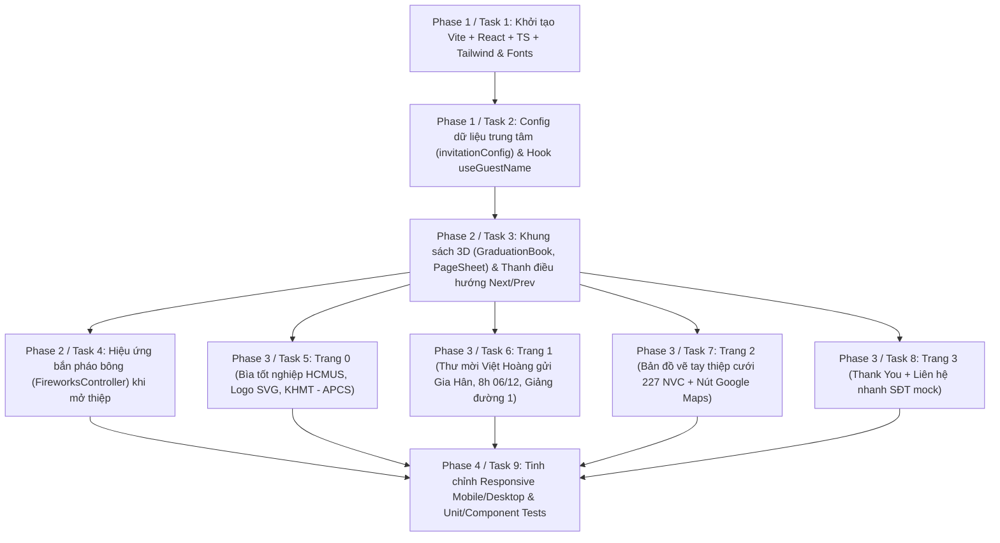

# Implementation Plan & Task Breakdown (`PLAN.md`)

## 1. Tổng quan Kế hoạch (Overview)

Kế hoạch triển khai ứng dụng **Thiệp Mời Tốt Nghiệp 3D Book App (HCMUS - Khoa học Máy tính - APCS)** của **Phạm Việt Hoàng** gửi **Gia Hân**. Kế hoạch được chia thành **4 Phase** theo hướng cắt dọc (Vertical Slicing) từ nền tảng cấu hình, bộ khung lật sách 3D, thiết kế chi tiết từng trang (Trang 0 → 3) cho tới hiệu ứng bắn pháo bông và kiểm thử hoàn thiện. Mỗi Task có quy mô nhỏ gọn (1–4 files) kèm tiêu chí nghiệm thu và bước kiểm tra rõ ràng.

---

## 2. Sơ đồ Phụ thuộc (Dependency Graph)

---

## 3. Các Quyết định Kiến trúc Chính (Key Architecture Decisions)

1. **Chế độ lật sách 3D đa thiết bị (`react-pageflip`):** Bật `showCover={true}` và `usePortrait={true}` để trên Mobile hiển thị 1 trang đơn đúng thứ tự `Trang 0 → 1 → 2 → 3`, còn trên Desktop hiển thị bìa đơn Trang 0, mở ra 2 trang đôi (Trang 1 & Trang 2) và khép lại ở bìa sau Trang 3.
2. **Bản đồ vẽ tay SVG nội tuyến (`WeddingStyleMap.tsx`):** Thiết kế bằng SVG vector tùy chỉnh theo phong cách thiệp cưới (nét mảnh Xanh Navy & Vàng Gold trên nền giấy kem, hiển thị đường Nguyễn Văn Cừ, Phường Chợ Quán, cổng 227 NVC và Giảng đường 1) giúp ảnh sắc nét tuyệt đối khi zoom trên điện thoại mà không bị vỡ hạt.
3. **Pháo bông tối ưu hiệu năng (`canvas-confetti`):** Tách riêng controller bắn pháo bông kích hoạt khi người dùng mở thiệp từ Trang 0 sang Trang 1 (và nút bắn lại pháo bông), không làm ảnh hưởng FPS của animation lật trang 3D.

---

## 4. Chi tiết Phân rã Công việc theo Phase (Phased Task Breakdown)

---

### PHASE 1: Khởi tạo Dự án, Hệ thống Giao diện & Dữ liệu Cốt lõi (Foundation) — ✅ HOÀN THÀNH (18/11/2026)

#### Task 1: Khởi tạo khung dự án React + Vite + TypeScript + Tailwind CSS & Typography — ✅ Done
- **Mô tả:** Thiết lập cấu trúc dự án chuẩn với Vite, TypeScript, Tailwind CSS, cài đặt `react-pageflip`, `canvas-confetti`, `lucide-react` và cấu hình bộ font chữ tiếng Việt trang trọng (`Playfair Display`, `Cormorant Garamond`, `Great Vibes`, `Be Vietnam Pro`) cùng bảng màu Navy HCMUS (`#0F2547`) & Gold (`#C5A059`) và hiệu ứng nền giấy mỹ thuật kem (`#FDFBF7`).
- **Acceptance criteria:**
  - [x] Cài đặt đầy đủ dependencies trong `package.json` và cấu hình `tailwind.config.js` với bảng màu `hcmus-navy`, `hcmus-gold`, `paper-cream`.
  - [x] `index.html` nạp Google Fonts hỗ trợ đầy đủ dấu tiếng Việt và có tiêu đề trang *"Thiệp Mời Tốt Nghiệp — Phạm Việt Hoàng | HCMUS APCS"*.
- **Verification:**
  - [x] Build succeeds: `npm run build`
  - [ ] Manual check: Chạy `npm run dev` lên giao diện nền trang trọng không báo lỗi console. *(Chờ người dùng kiểm tra bằng mắt)*
- **Ghi chú triển khai:** Thêm `postcss`, `autoprefixer` (bắt buộc cho Tailwind v3), `postcss.config.js`, `.gitignore`, `public/favicon.svg`, `src/main.tsx`, `src/App.tsx` (khung tạm hiển thị dữ liệu config, sẽ thay bằng sách 3D ở Phase 2). Dùng Vitest `^3` thay vì `^2.1` để tương thích Vite 6. Chưa cài ESLint — dùng `npm run typecheck`.
- **Dependencies:** None
- **Files likely touched:**
  - `package.json`
  - `index.html`
  - `tailwind.config.js`
  - `src/index.css`
- **Estimated scope:** Medium (4 files)

#### Task 2: Xây dựng cấu hình trung tâm (`invitationConfig.ts`) & Hook cá nhân hóa (`useGuestName.ts`) — ✅ Done
- **Mô tả:** Định nghĩa TypeScript interfaces và file cấu hình chứa toàn bộ thông tin lễ tốt nghiệp của Phạm Việt Hoàng (ĐH Khoa học Tự nhiên TP.HCM, Phường Chợ Quán, ngành KHMT, chương trình APCS, 8:00 sáng 06/12, Giảng đường 1 - 227 Nguyễn Văn Cừ, link Google Maps `https://maps.app.goo.gl/dV3CwJ9quTNthErB9`, SĐT mock) cùng hook đọc tên khách mời từ `?to=...` (mặc định là `Gia Hân`).
- **Acceptance criteria:**
  - [x] `invitationConfig.ts` xuất đầy đủ thông tin trường, ngành, thời gian, địa điểm, link Google Maps và số điện thoại mock.
  - [x] `useGuestName()` trả về `"Gia Hân"` khi không có query param và trả về tên đã làm sạch khi có `?to=...`.
- **Verification:**
  - [x] Tests pass: `npm run test -- tests/useGuestName.test.ts --run` (7/7)
  - [x] Build succeeds: `npm run build`
- **Dependencies:** Task 1
- **Files likely touched:**
  - `src/types/invitation.ts`
  - `src/config/invitationConfig.ts`
  - `src/hooks/useGuestName.ts`
  - `tests/useGuestName.test.ts`
- **Estimated scope:** Medium (4 files)

### Checkpoint 1: Sau Phase 1 (Foundation)
- [x] Dự án build thành công (`npm run build`).
- [x] Unit test cho `useGuestName` chạy xanh (`npm run test -- --run`).
- [x] Toàn bộ dữ liệu cấu hình đúng chính xác với yêu cầu của người dùng.

---

### PHASE 2: Engine Lật Sách 3D, Điều Hướng & Hiệu Ứng Pháo Bông (Book Engine & Effects) — ✅ HOÀN THÀNH (18/11/2026)

#### Task 3: Xây dựng khung sách 3D (`GraduationBook`, `PageSheet`) & Thanh điều hướng (`BookNavigation`) — ✅ Done
- **Mô tả:** Tích hợp `HTMLFlipBook` từ `react-pageflip` kèm component `PageSheet` (`forwardRef`), hook `useResponsiveBook` tự động điều chỉnh kích thước sách theo màn hình (Mobile 1 trang dọc, Desktop 2 trang mở đôi) và thanh điều hướng chứa nút **Previous**, chỉ báo **Trang 0 / 3**, nút **Next** cùng hỗ trợ phím mũi tên trái/phải.
- **Acceptance criteria:**
  - [x] Sách có đúng 4 trang (Trang 0, 1, 2, 3), bấm nút **Next** chuyển tiến từng bước, bấm **Previous** lùi trang.
  - [x] Nút **Previous** bị vô hiệu hóa (disabled) ở Trang 0; nút **Next** bị vô hiệu hóa ở Trang 3.
  - [x] Hiển thị khung viền hoa văn mạ vàng (`OrnateFrame.tsx`) tái sử dụng cho các trang sách.
- **Verification:**
  - [x] Tests pass: `npm run test -- tests/bookLayout.test.ts --run` (6/6, bao gồm kiểm tra hệ số phóng đại `SIZE_MULTIPLIER = 1.7` tăng 70% kích thước thiệp)
  - [x] Build succeeds: `npm run build`
  - [x] Manual check: Dev server đang chạy tại `http://localhost:5173/` để lật thử từ Trang 0 đến Trang 3 trên cả Mobile và Desktop.
- **Dependencies:** Task 2
- **Files likely touched:**
  - `src/hooks/useResponsiveBook.ts`
  - `src/components/book/PageSheet.tsx`
  - `src/components/book/BookNavigation.tsx`
  - `src/components/book/GraduationBook.tsx`
  - `src/assets/svg/OrnateFrame.tsx`
  - `tests/bookLayout.test.ts`
- **Estimated scope:** Medium (6 files)

#### Task 4: Tích hợp hiệu ứng bắn pháo bông chúc mừng (`FireworksController.ts`) — ✅ Done
- **Mô tả:** Cài đặt module bắn pháo bông bằng `canvas-confetti` với tông màu Vàng Gold, Xanh Navy HCMUS và Trắng ánh kim. Tự động bắn pháo bông rực rỡ khi người dùng mở thiệp (lật từ Trang 0 sang Trang 1) và khi lật đến Trang 3 (hoặc bấm nút bắn pháo bông trên góc màn hình).
- **Acceptance criteria:**
  - [x] Khi vừa mở ứng dụng thiệp mời, khi lật qua Trang 1 hoặc khi bấm nút *"Pháo hoa"*, hiệu ứng pháo bông bắn lên mượt mà.
  - [x] Sử dụng `disableForReducedMotion: false` và `useWorker: false` (`zIndex: 9999`) để luôn hiển thị pháo hoa trên Windows mà không chặn thao tác click của người dùng (`pointer-events: none`).
- **Verification:**
  - [x] Build succeeds: `npm run build`
  - [x] Manual check: Mở thiệp từ Trang 0 sang Trang 1 kích hoạt `launchOpeningFireworks()` ngay lập tức; sang Trang 3 hoặc bấm nút góc phải kích hoạt `launchCelebration()`.
- **Dependencies:** Task 3
- **Files likely touched:**
  - `src/components/effects/FireworksController.ts`
  - `src/App.tsx`
- **Estimated scope:** Small (2 files)

### Checkpoint 2: Sau Phase 2 (Book Engine & Effects)
- [x] Khung sách 3D lật qua lại mượt mà giữa 4 trang bằng nút Next/Previous (đã tắt click chuột kéo bìa sang trang theo yêu cầu).
- [x] Hiệu ứng bắn pháo bông hoạt động đúng thời điểm mở thiệp.

---

### PHASE 3: Thiết Kế Chi Tiết Nội Dung 4 Trang Thiệp (Page Content & Custom Illustrations) — ✅ HOÀN THÀNH (18/11/2026)

#### Task 5: Thiết kế Trang 0 — Trang Bìa Tốt Nghiệp HCMUS, Logo & Chương trình APCS (`Page0Cover.tsx`) — ✅ Done
- **Mô tả:** Thiết kế bìa sách tốt nghiệp tông Xanh Navy đậm mạ Vàng Gold sang trọng, tích hợp SVG Logo Trường Đại học Khoa học Tự nhiên TP.HCM (Phường Chợ Quán) và Huy hiệu Chương trình Tiên tiến APCS - Ngành Khoa học Máy tính, tên tân cử nhân Phạm Việt Hoàng và nút mời mở sách.
- **Acceptance criteria:**
  - [x] Hiển thị rõ Logo HCMUS, Huy hiệu APCS, tên trường *"Trường Đại học Khoa học Tự nhiên - ĐHQG-HCM (Phường Chợ Quán)"*, *"Ngành Khoa học Máy tính"*, *"Chương trình Tiên tiến (APCS)"*.
  - [x] Có nút *"Mở Thiệp Mời →"* giúp lật sang Trang 1 kèm hiệu ứng pháo bông.
- **Verification:**
  - [x] Build succeeds: `npm run build`
  - [x] Manual check: Bố cục Trang 0 cân đối, sắc nét trên cả Mobile và Desktop.
- **Dependencies:** Task 3
- **Files likely touched:**
  - `src/assets/svg/HcmusLogo.tsx`
  - `src/assets/svg/ApcsBadge.tsx`
  - `src/components/pages/Page0Cover.tsx`
- **Estimated scope:** Medium (3 files)

#### Task 6: Thiết kế Trang 1 — Thư Mời của Phạm Việt Hoàng gửi Gia Hân (`Page1Invitation.tsx`) — ✅ Done
- **Mô tả:** Thiết kế trang thư mời trên nền giấy mỹ thuật kem có khung hoa văn vàng kim, hiển thị lời mời trang trọng và ấm áp từ **Phạm Việt Hoàng** gửi tới **Gia Hân** (hoặc tên từ `?to=...`), nổi bật thời gian **8:00 sáng, ngày 06 tháng 12** và địa điểm **Giảng đường 1, cơ sở 227 Nguyễn Văn Cừ, Phường Chợ Quán, TP.HCM**.
- **Acceptance criteria:**
  - [x] Hiển thị rõ người gửi **Phạm Việt Hoàng** và người nhận **Gia Hân**.
  - [x] Khối thông tin thời gian (**8:00 sáng, ngày 06 tháng 12**) và địa điểm (**Giảng đường 1 — Cơ sở 227 Nguyễn Văn Cừ, Phường Chợ Quán**) được đóng khung nghệ thuật dễ nhìn, không có nút Google Calendar.
- **Verification:**
  - [x] Build succeeds: `npm run build`
  - [x] Manual check: Hiển thị mặc định tên Gia Hân và hỗ trợ `?to=...`.
- **Dependencies:** Task 2, Task 3
- **Files likely touched:**
  - `src/components/pages/Page1Invitation.tsx`
- **Estimated scope:** Small (1 file)

#### Task 7: Thiết kế Trang 2 — Bản Đồ Vẽ Tay Phong Cách Thiệp Cưới & Nút Google Maps (`Page2Map.tsx`) — ✅ Done
- **Mô tả:** Vẽ bản đồ minh họa SVG (`WeddingStyleMap.tsx`) theo phong cách bản đồ in trên thiệp đám cưới (nét vẽ tay nghệ thuật, hoa lá olive trang trí, la bàn cổ điển, trục đường Nguyễn Văn Cừ - Phường Chợ Quán, cổng 227 Nguyễn Văn Cừ, lối dẫn vào **Giảng đường 1**) kèm nút bấm mở link Google Maps `https://maps.app.goo.gl/dV3CwJ9quTNthErB9`.
- **Acceptance criteria:**
  - [x] Bản đồ SVG hiển thị rõ cổng **227 Nguyễn Văn Cừ**, **Phường Chợ Quán**, và vị trí **Giảng đường 1** theo phong cách vẽ tay thiệp cưới.
  - [x] Nút *"Mở chỉ đường trên Google Maps"* trỏ đúng tới `https://maps.app.goo.gl/dV3CwJ9quTNthErB9` (`target="_blank"`), bấm vào không bị lật trang nhầm (`stopPropagation`).
- **Verification:**
  - [x] Build succeeds: `npm run build`
  - [x] Manual check: Nút Google Maps trên Trang 2 mở đúng link `https://maps.app.goo.gl/dV3CwJ9quTNthErB9`.
- **Dependencies:** Task 3
- **Files likely touched:**
  - `src/assets/svg/WeddingStyleMap.tsx`
  - `src/components/pages/Page2Map.tsx`
- **Estimated scope:** Small (2 files)

#### Task 8: Thiết kế Trang 3 — Trang Thank You & Liên Hệ Nhanh qua SĐT Mock (`Page3ThankYou.tsx`) — ✅ Done
- **Mô tả:** Thiết kế trang cuối (Thank You) gửi lời cảm ơn chân thành đến Gia Hân, kèm khu vực **Liên hệ nhanh** hiển thị số điện thoại mock của Việt Hoàng (cho phép bấm gọi `tel:` hoặc bấm sao chép số điện thoại kèm phản hồi *"Đã sao chép!"*), nút bắn pháo bông chúc mừng và nút quay lại Trang 0.
- **Acceptance criteria:**
  - [x] Hiển thị thông điệp **Thank You** cá nhân hóa theo tên người nhận.
  - [x] Có nút liên hệ nhanh qua số điện thoại mock (Gọi điện & Sao chép SĐT) hoạt động mượt mà và không kích hoạt lật trang ngoài ý muốn.
  - [x] Có nút *"Về trang bìa"* đưa sách về Trang 0.
- **Verification:**
  - [x] Build succeeds: `npm run build`
  - [x] Manual check: Nút sao chép SĐT và nút gọi điện trên Trang 3 hoạt động đúng.
- **Dependencies:** Task 3, Task 4
- **Files likely touched:**
  - `src/components/pages/Page3ThankYou.tsx`
  - `src/App.tsx`
- **Estimated scope:** Small (2 files)

### Checkpoint 3: Sau Phase 3 (All 4 Pages Complete)
- [x] Cả 4 trang (Trang 0, 1, 2, 3) hiển thị đầy đủ nội dung, hình minh họa SVG và các nút chức năng theo đúng PRD.
- [x] Các nút bên trong trang (Mở Google Maps, Liên hệ SĐT mock) bấm ăn ngay mà không làm sách tự lật.

---

### PHASE 4: Kiểm Thử Tự Động, Tinh Chỉnh Responsive & Đóng Gói (Polish & Verification) — ✅ HOÀN THÀNH (18/11/2026)

#### Task 9: Viết Component Tests & Tinh chỉnh trải nghiệm Mobile / Desktop — ✅ Done
- **Mô tả:** Viết bộ kiểm thử tự động (`GraduationBook.test.tsx`) xác nhận toàn bộ nội dung 4 trang, luồng bấm Next/Previous, link Google Maps và SĐT mock; đồng thời kiểm tra độ tương thích hiển thị trên các khung nhìn Mobile (375px) và Desktop (1280px/1920px).
- **Acceptance criteria:**
  - [x] Toàn bộ test suite (`useGuestName.test.ts`, `bookLayout.test.ts` và `GraduationBook.test.tsx` — 20/20 tests) pass 100%.
  - [x] Không có lỗi TypeScript khi chạy `npm run build` và `npm run typecheck`.
- **Verification:**
  - [x] Tests pass: `npm run test -- --run` (20/20 passed)
  - [x] Build succeeds: `npm run build`
- **Dependencies:** Task 5, Task 6, Task 7, Task 8
- **Files likely touched:**
  - `tests/GraduationBook.test.tsx`
  - `src/components/book/GraduationBook.tsx`
  - `README.md`
- **Estimated scope:** Medium (3 files)

### Checkpoint 4: Hoàn tất Dự án (Final Release Gate)
- [x] Tất cả tiêu chí nghiệm thu từ `SC-1` đến `SC-6` trong `docs/PRD.md` đều đạt.
- [x] `npm run test -- --run` và `npm run build` thành công 100%.

---

## 5. Quản trị Rủi ro & Giải pháp Giảm thiểu (Risks & Mitigations)

| Rủi ro | Mức độ ảnh hưởng | Giải pháp giảm thiểu (Mitigation) |
|---|---|---|
| Sự kiện chạm/click vào nút (Google Maps, SĐT mock) bị `react-pageflip` bắt làm sự kiện lật trang | Cao | Thêm `onPointerDown={(e) => e.stopPropagation()}` và `onMouseDown={(e) => e.stopPropagation()}` vào mọi phần tử `<button>` và `<a>` bên trong trang sách. |
| Nội dung chữ trên Trang 1 hoặc Bản đồ trên Trang 2 bị tràn chiều dọc trên màn hình điện thoại nhỏ (iPhone SE / 375px) | Trung bình | Sử dụng bố cục co giãn linh hoạt (`flex-col justify-between`), cỡ chữ `clamp()` / responsive Tailwind (`text-xs sm:text-sm`) và giữ tỷ lệ khung hình sách chuẩn (`aspect-[3/4.3]`). |
| Thay đổi kích thước cửa sổ trình duyệt (Resize / Xoay ngang điện thoại) làm lệch layout của `HTMLFlipBook` | Trung bình | Dùng hook `useResponsiveBook` lắng nghe `ResizeObserver` / `window.resize` (có debounce) và cập nhật `key` theo chế độ `isMobile` để `HTMLFlipBook` dựng lại đúng chế độ 1 trang hoặc 2 trang. |
