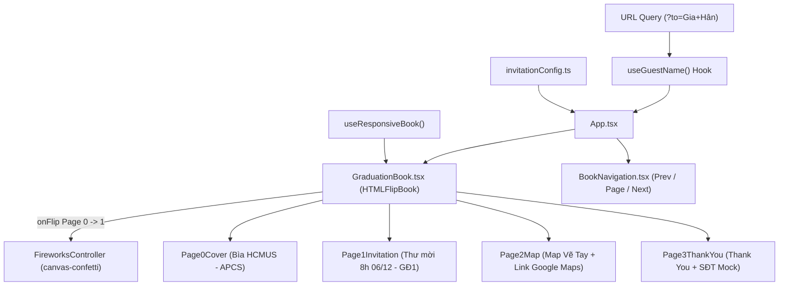

# Technical Architecture & Specification (`TECH_ARCHITECTURE.md`)

## 1. Mục tiêu Kỹ thuật (Technical Objective)

Thiết kế kiến trúc ứng dụng web tĩnh (Single-Page Static Web Application) gọn nhẹ, tốc độ tải tức thì, hiệu ứng lật sách 3D chân thực trên cả Mobile (1 trang đơn) và Desktop (sách mở đôi), tích hợp hiệu ứng bắn pháo bông bằng HTML5 Canvas và bộ minh họa vector (SVG) độc quyền cho Lễ Tốt Nghiệp của Phạm Việt Hoàng tại Trường ĐH Khoa học Tự nhiên, ĐHQG-HCM (HCMUS - APCS).

---

## 2. Công nghệ Sử dụng (Tech Stack)

| Tầng (Layer) | Công nghệ / Thư viện | Phiên bản đề xuất | Vai trò |
|---|---|---|---|
| **Core Framework** | React + TypeScript | React `^18.3.1`, TS `^5.6.x` | Xây dựng UI component-based an toàn kiểu dữ liệu |
| **Build Tool** | Vite | `^6.0.x` | Bundler tốc độ cao, tối ưu static assets |
| **Styling** | Tailwind CSS + PostCSS + Autoprefixer | `^3.4.x` | Thiết kế hệ thống màu HCMUS Navy & Gold, họa tiết giấy mỹ thuật, responsive (PostCSS/Autoprefixer là yêu cầu bắt buộc của Tailwind v3) |
| **3D Book Flip** | `react-pageflip` (`page-flip`) | `^2.0.3` | Engine lật trang sách 3D hỗ trợ `showCover`, Mobile 1 trang & Desktop 2 trang |
| **Fireworks Effect** | `canvas-confetti` + `@types/canvas-confetti` | `^1.9.3` | Hiệu ứng bắn pháo bông nhẹ, chạy trên Web Worker / HTML5 Canvas |
| **Icons** | `lucide-react` | `^0.460.x` | Bộ icon sắc nét cho nút điều hướng, bản đồ, liên hệ nhanh |
| **Testing** | Vitest + React Testing Library + jsdom | Vitest `^3.0.x` (tương thích Vite 6) | Unit test & Component test cho luồng lật trang, URL param và dữ liệu |

---

## 3. Lệnh Thực Thi Chuẩn (Executable Commands)

```bash
# Cài đặt dependencies
npm install

# Chạy môi trường phát triển (Dev Server tại http://localhost:5173)
npm run dev

# Kiểm tra lỗi TypeScript và Build bản Production tĩnh (ra thư mục dist/)
npm run build

# Xem thử bản Production sau khi build
npm run preview

# Chạy toàn bộ Unit & Component Tests
npm run test -- --run

# Kiểm tra kiểu TypeScript (thay cho ESLint — ESLint chưa được cài, cần duyệt trước khi thêm)
npm run typecheck
```

---

## 4. Cấu trúc Thư mục Dự án (Project Directory Structure)

```text
graduation-invitation/
├── docs/
│   ├── intent/
│   │   └── graduation-invitation.md   # Bản chốt yêu cầu (Statement of Intent)
│   ├── PRD.md                         # Tài liệu yêu cầu sản phẩm chi tiết
│   ├── TECH_ARCHITECTURE.md           # Tài liệu kiến trúc kỹ thuật & Spec
│   └── PLAN.md                        # Kế hoạch triển khai theo Phase & Task
├── public/
│   └── favicon.svg                    # Icon mũ cử nhân HCMUS vàng gold
├── src/
│   ├── assets/
│   │   └── svg/
│   │       ├── HcmusLogo.tsx          # Logo vector ĐH Khoa học Tự nhiên (HCMUS)
│   │       ├── ApcsBadge.tsx          # Huy hiệu Chương trình Tiên tiến APCS - KHMT
│   │       ├── WeddingStyleMap.tsx    # Bản đồ vẽ tay phong cách thiệp cưới (227 NVC - Giảng đường 1)
│   │       └── OrnateFrame.tsx        # Khung viền hoa văn cổ điển mạ vàng trên nền giấy kem
│   ├── components/
│   │   ├── book/
│   │   │   ├── GraduationBook.tsx     # Container quản lý react-pageflip, trạng thái trang & responsive
│   │   │   ├── BookNavigation.tsx     # Thanh nút Previous / Chỉ số trang / Next
│   │   │   └── PageSheet.tsx          # Wrapper `React.forwardRef` chuẩn hóa cho từng trang giấy
│   │   ├── pages/
│   │   │   ├── Page0Cover.tsx         # Trang 0: Bìa tốt nghiệp HCMUS, Logo, KHMT - APCS
│   │   │   ├── Page1Invitation.tsx    # Trang 1: Thư mời Việt Hoàng gửi Gia Hân (8h 06/12, Giảng đường 1)
│   │   │   ├── Page2Map.tsx           # Trang 2: Bản đồ vẽ tay 227 Nguyễn Văn Cừ + Nút mở Google Maps
│   │   │   └── Page3ThankYou.tsx      # Trang 3: Lời cảm ơn + Liên hệ nhanh qua SĐT mock
│   │   └── effects/
│   │       └── FireworksController.ts # Module điều khiển hiệu ứng bắn pháo bông (`canvas-confetti`)
│   ├── config/
│   │   └── invitationConfig.ts        # Nguồn dữ liệu cấu hình duy nhất (Single Source of Truth)
│   ├── hooks/
│   │   ├── useGuestName.ts            # Hook đọc query `?to=...` và fallback về "Gia Hân"
│   │   └── useResponsiveBook.ts       # Hook tính toán kích thước sách & chế độ Mobile/Desktop
│   ├── types/
│   │   └── invitation.ts              # TypeScript interfaces cho cấu hình và trạng thái trang
│   ├── App.tsx                        # Layout nền, hiệu ứng pháo bông và nhúng GraduationBook
│   ├── main.tsx                       # Entry point React
│   └── index.css                      # Tailwind directives, font import & hiệu ứng vân giấy mỹ thuật
├── tests/
│   ├── useGuestName.test.ts           # Test logic cá nhân hóa tên người nhận
│   └── GraduationBook.test.tsx        # Test hiển thị 4 trang, nút Next/Prev và link Google Maps
├── index.html
├── package.json
├── tailwind.config.js
├── tsconfig.json
└── vite.config.ts
```

---

## 5. Thiết kế Kiến trúc Chi tiết (Detailed Component & System Design)

### 5.1. Kiến trúc Sơ đồ Luồng (Architecture Diagram)



### 5.2. Cấu hình Dữ liệu Trung tâm (`src/config/invitationConfig.ts`)

Toàn bộ dữ liệu văn bản, thời gian, địa điểm, đường dẫn bản đồ và số điện thoại mock được gom về một object có kiểu tĩnh rõ ràng để dễ dàng bảo trì:

```typescript
export interface InvitationConfig {
  university: {
    nameVi: string;
    nameEn: string;
    campusWard: string;
    faculty: string;
    major: string;
    program: string;
  };
  graduate: {
    fullName: string;
    shortName: string;
    degreeTitle: string;
    mockPhoneDisplay: string;
    mockPhoneTel: string;
  };
  guest: {
    defaultName: string;
  };
  ceremony: {
    timeDisplay: string;
    dateDisplay: string;
    hallName: string;
    addressDisplay: string;
    googleMapsUrl: string;
  };
}

export const invitationConfig: InvitationConfig = {
  university: {
    nameVi: 'TRƯỜNG ĐẠI HỌC KHOA HỌC TỰ NHIÊN - ĐHQG-HCM',
    nameEn: 'VNU-HCM University of Science (HCMUS)',
    campusWard: 'Phường Chợ Quán, TP. Hồ Chí Minh',
    faculty: 'Khoa Công nghệ Thông tin',
    major: 'Ngành Khoa học Máy tính',
    program: 'Chương trình Tiên tiến (APCS)',
  },
  graduate: {
    fullName: 'Phạm Việt Hoàng',
    shortName: 'Việt Hoàng',
    degreeTitle: 'Cử nhân Khoa học Máy tính — APCS',
    mockPhoneDisplay: '0909 123 456',
    mockPhoneTel: '0909123456',
  },
  guest: {
    defaultName: 'Gia Hân',
  },
  ceremony: {
    timeDisplay: '08:00 Sáng',
    dateDisplay: 'Ngày 06 tháng 12',
    hallName: 'Giảng đường 1',
    addressDisplay: 'Cơ sở 227 Nguyễn Văn Cừ, Phường Chợ Quán, TP. Hồ Chí Minh',
    googleMapsUrl: 'https://maps.app.goo.gl/dV3CwJ9quTNthErB9',
  },
};
```

### 5.3. Cơ chế Lật Sách 3D & Wrapper `PageSheet` (`react-pageflip`)

- Thư viện `react-pageflip` yêu cầu mỗi trang con bên trong `<HTMLFlipBook>` phải được bọc bởi `React.forwardRef<HTMLDivElement, PageSheetProps>` để engine tính toán ma trận biến đổi 3D.
- Cấu hình `<HTMLFlipBook>`:
  - `showCover={true}`: Giúp **Trang 0** đóng vai trò bìa cứng phía trước và **Trang 3** đóng vai trò bìa cứng phía sau.
  - `usePortrait={true}`: Trên màn hình hẹp (Mobile < 768px), sách tự động chuyển về chế độ lật từng trang đơn (`Trang 0` → `Trang 1` → `Trang 2` → `Trang 3`). Trên Desktop (≥ 768px), khi mở bìa Trang 0 sẽ hiện song song **Trang 1 (trái)** và **Trang 2 (phải)**, lật tiếp sẽ tới **Trang 3 (bìa sau)**.
  - `useMouseEvents={false}` & `showPageCorners={false}` & `disableFlipByClick={true}`: Tắt hoàn toàn tính năng click chuột / kéo góc bìa để sang trang; việc lật trang chỉ thực hiện thông qua nút **Next / Previous** (và các nút điều hướng rõ ràng).
- **Lưu ý tương tác nút bấm trong `react-pageflip`:** Các nút tương tác bên trong trang sách (như nút *"Mở Google Maps"* ở Trang 2 và nút *"Gọi điện / Sao chép SĐT"* ở Trang 3) cần dừng lan truyền sự kiện (`onPointerDown={(e) => e.stopPropagation()}` / `onMouseDown={(e) => e.stopPropagation()}`) để khi người dùng bấm nút không bị kích hoạt nhầm hành động lật trang.

### 5.4. Thiết kế Bản đồ Vẽ tay Phong cách Thiệp cưới (`WeddingStyleMap.tsx`)

Thay vì dùng iframe bản đồ thô cứng, `WeddingStyleMap.tsx` là một bản vẽ minh họa SVG chất lượng cao mang phong cách **Wedding Invitation Hand-Drawn Map**:
- **Tông màu nét vẽ:** Xanh Navy cổ điển (`#1B365D`) và Vàng đồng (`#C5A059`) trên nền giấy kem (`#FAF6EE`).
- **Bố cục địa lý minh họa:**
  - Trục đường lớn **Nguyễn Văn Cừ** chạy dọc rõ nét kèm tên phường **Phường Chợ Quán**.
  - Các tuyến đường giao cắt mang tính định vị: **An Dương Vương**, **Trần Phú**, **Nguyễn Trãi**.
  - Hình vẽ cổng trường biểu tượng **227 Nguyễn Văn Cừ (ĐH Khoa học Tự nhiên)** với hàng cây/nhành lá olive trang trí kiểu thiệp cưới.
  - Đường nét đứt dẫn lối từ cổng 227 Nguyễn Văn Cừ vào tòa nhà **Giảng đường 1** (kèm biểu tượng ngôi sao / ghim trái tim học thuật và nhãn nổi bật `"Giảng đường 1"`).
  - La bàn cổ điển (Vintage Compass Rose) ở góc bản đồ.
- Ngay bên dưới bản đồ là nút CTA mở trực tiếp `https://maps.app.goo.gl/dV3CwJ9quTNthErB9` trong tab mới (`target="_blank" rel="noopener noreferrer"`).

### 5.5. Hệ thống Hiệu ứng Bắn Pháo Bông (`FireworksController.ts`)

- Sử dụng `canvas-confetti` tạo hiệu ứng bắn pháo bông đa đợt (multi-burst fireworks) từ hai bên cánh gà và giữa màn hình với bảng màu `['#D4AF37', '#F3E5AB', '#1B365D', '#3B82F6', '#FFFFFF']`.
- **Thời điểm kích hoạt:**
  1. Ngay khi người dùng vừa mở ứng dụng thiệp mời (khi tải trang lần đầu ở Trang 0) và khi lật mở bìa từ **Trang 0 → Trang 1**.
  2. Khi người dùng lật tới **Trang 3 (Thank You)** hoặc bấm nút **"Pháo hoa"** ở góc trên bên phải màn hình / nút **"Bắn pháo bông"** ở Trang 3.
- Cấu hình `confetti.create(undefined, { resize: true, useWorker: false })` với `disableForReducedMotion: false` và `zIndex: 9999` để đảm bảo pháo hoa luôn hiển thị rực rỡ trên mọi máy Windows (kể cả khi Windows tắt Animation effects).

---

## 6. Quy Chuẩn Code (Code Style & Conventions)

- Sử dụng Functional Components với TypeScript nghiêm ngặt (`strict: true`, không dùng `any`).
- Sử dụng `React.forwardRef` chuẩn xác cho các trang trong `HTMLFlipBook`:

```tsx
import React, { forwardRef } from 'react';

interface PageSheetProps {
  children: React.ReactNode;
  pageNumber: number;
  variant?: 'cover' | 'inner';
}

export const PageSheet = forwardRef<HTMLDivElement, PageSheetProps>(
  ({ children, pageNumber, variant = 'inner' }, ref) => {
    const isCover = variant === 'cover';
    return (
      <div
        ref={ref}
        data-testid={`book-page-${pageNumber}`}
        className={`relative h-full w-full select-none overflow-hidden shadow-inner ${
          isCover
            ? 'bg-[#0F2547] text-[#FDFBF7]'
            : 'bg-[#FDFBF7] text-[#1E293B]'
        }`}
      >
        {children}
      </div>
    );
  }
);

PageSheet.displayName = 'PageSheet';
```

---

## 7. Chiến lược Kiểm thử (Testing Strategy)

- **Công cụ:** `Vitest` + `@testing-library/react` + `jsdom`.
- **Vị trí file test:** Thư mục `tests/`.
- **Các kịch bản kiểm thử bắt buộc:**
  1. `useGuestName.test.ts`:
     - Trả về `"Gia Hân"` khi URL không có query `?to`.
     - Trả về tên đã decode khi URL có `?to=Minh%20Anh`.
     - Xử lý an toàn khi `?to=` rỗng hoặc chứa khoảng trắng.
  2. `GraduationBook.test.tsx`:
     - Render đầy đủ 4 trang (`book-page-0`, `book-page-1`, `book-page-2`, `book-page-3`).
     - Trang 0 hiển thị đúng `"Khoa học máy tính"`, `"APCS"`, `"Khoa học tự nhiên"`.
     - Trang 1 hiển thị đúng `"Phạm Việt Hoàng"`, `"Gia Hân"`, `"08:00"`, `"06 tháng 12"`, `"Giảng đường 1"`, `"227 Nguyễn Văn Cừ"`.
     - Trang 2 có thẻ link trỏ đúng tới `https://maps.app.goo.gl/dV3CwJ9quTNthErB9`.
     - Trang 3 hiển thị `"Thank You"` và số điện thoại mock.
     - Nút Next và Previous chuyển trang hoạt động đúng.

---

## 8. Ranh Giới Kỹ Thuật (Three-Tier Boundaries)

- **Always do (Luôn thực hiện):**
  - Giữ toàn bộ dữ liệu cấu hình trong `src/config/invitationConfig.ts`.
  - Chặn sự kiện nổi bọt (`stopPropagation`) trên các nút bấm bên trong trang sách để không gây lỗi lật trang ngoài ý muốn.
  - Chạy `npm run build` và `npm run test -- --run` trước khi hoàn thành mỗi Phase.
- **Ask first (Hỏi ý kiến trước):**
  - Thêm bất kỳ thư viện bên thứ ba nào ngoài danh sách Tech Stack đã duyệt.
  - Thay đổi cấu trúc 4 trang (Trang 0 → 1 → 2 → 3) hoặc thay đổi tông màu Navy & Gold đã chốt.
- **Never do (Tuyệt đối không làm):**
  - Không thêm Backend, Database, hoặc gọi API thu thập dữ liệu người dùng.
  - Không thêm tính năng Google Calendar (theo yêu cầu người dùng).
  - Không hardcode rải rác số điện thoại mock hay link Google Maps ở nhiều component khác nhau.
